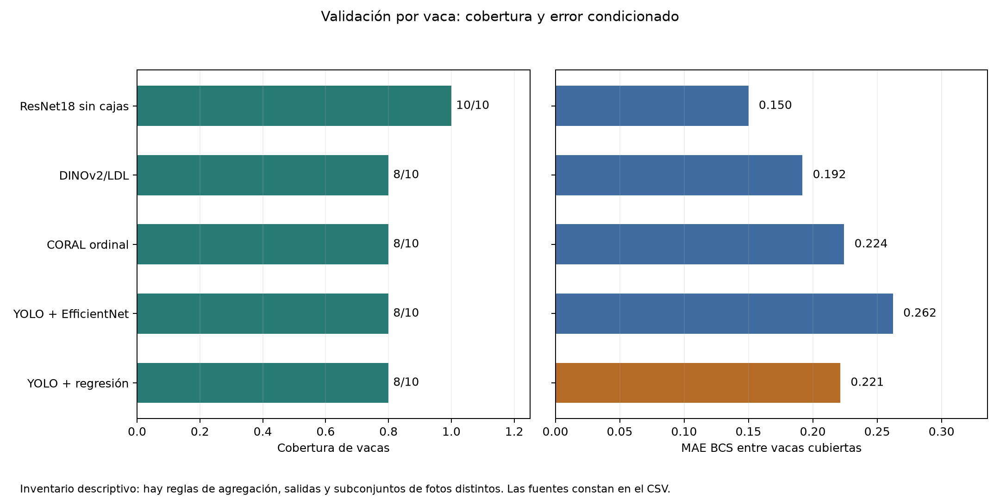

# Comparación preliminar de modelos BCS

Esta carpeta guarda la primera comparación que hicimos de los modelos del equipo, el 12 de noviembre de 2026. Juntamos las cifras de validación que ya tenía cada modelo, todas sobre las 36 fotos de las 10 vacas de validación, y volvimos a correr DINOv2 + LDL, EfficientNet de clasificación y CORAL con el mismo detector para que cubrieran las mismas fotos.

No la usamos para elegir el modelo porque las cifras no eran comparables entre sí. Cada modelo medía con una unidad distinta (foto o vaca), unos usaban cajas anotadas y otros cajas del detector, y el detector dejaba sin predicción entre 6 y 12 de las 36 fotos. Con 8 a 10 vacas cubiertas cualquier diferencia quedaba dentro del ruido. Por eso volvimos a entrenar los seis enfoques con las mismas 66 vacas y los mismos pliegues en [`evaluacion/comparacion_validacion_cruzada`](../comparacion_validacion_cruzada/), que es la comparación con la que aprobamos el [modelo final](../../modelos/Modelo%20final%20DINOv2%20ridge%20BCS/).



Entre los tres clasificadores con el mismo detector, DINOv2 + LDL tenía el menor error por vaca (0.192 en 8 vacas), seguido de CORAL (0.224) y EfficientNet de clasificación (0.262), y la validación cruzada confirmó ese orden. ResNet18 daba 0.150 en sus 10 vacas de validación, pero con la validación cruzada subió a 0.354. Ese cambio es la razón por la que no bastaba con 10 vacas para decidir.

## Contenido

`datos_agregados_validacion.csv` tiene las cifras por foto de cada modelo y `datos_agregados_vaca_validacion.csv` las cifras por vaca. `clasificadores_pareados_validacion.csv` compara los tres clasificadores que comparten detector sobre las mismas 24 fotos. Ninguno tiene identificadores de vacas ni predicciones individuales. La columna `evidencia` indica si la cifra viene del reporte del modelo o si la recalculamos con las predicciones locales.

`generar_graficas.py` hace las figuras de `figuras/` a partir de esos CSV. Desde la raíz del repositorio:

```bash
python -m evaluacion.comparacion_modelos.generar_graficas
```

`confusiones_pareadas.py`, `evaluador_comun.py` y `adaptadores_locales.py` leen las predicciones locales de cada corrida, revisan que se comparen las mismas fotos y solo escriben conteos agregados. Las pruebas están en `tests/` y usan datos ficticios.
