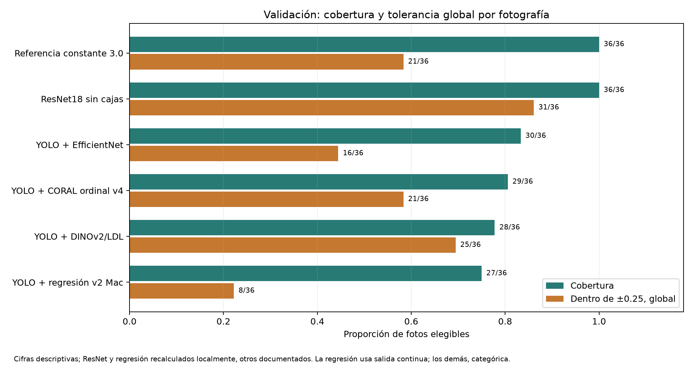
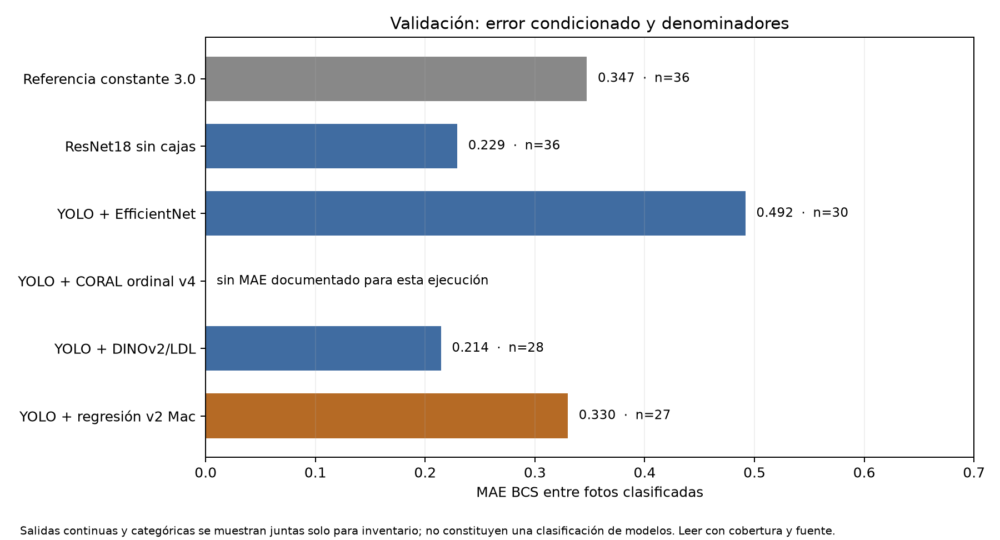

# Comparación maestra BCS: corte preliminar

**Fecha:** 10 de noviembre de 2026. **Partición:** validación. **Estado:** inventario descriptivo; todavía no es una selección de modelo.

## Qué se puede comparar hoy

Los cinco enfoques tienen alguna cifra de validación sobre 36 fotografías, pero la evidencia no es uniforme. Las predicciones individuales de ResNet18 y de YOLO + regresión v2 Mac se encontraron localmente y permitieron recalcular métricas. Para los otros tres enfoques, las cifras provienen de informes de Drive: documentan ejecuciones reales, pero faltan sus archivos privados de predicciones para reproducir una comparación por vaca. Véase [INVENTARIO.md](INVENTARIO.md) para la procedencia de cada fila.

| Sistema | Salida | Fotos con predicción / 36 | Dentro de ±0.25 / 36 | MAE en fotos con predicción |
|---|---|---:|---:|---:|
| Constante 3.0 | Categoría | 36 | 21 | 0.3472 |
| ResNet18 sin cajas | Categoría | 36 | 31 | 0.2292 |
| YOLO + EfficientNet | Categoría | 30 | 16 | 0.4917 |
| YOLO + CORAL ordinal v4 | Categoría | 29 | 21 | No documentado para el flujo automático |
| YOLO + DINOv2/LDL | Categoría | 28 | 25 | 0.2143 |
| YOLO + regresión v2 Mac | Continua | 27 | 8 | 0.3299 |

El acierto global incluye las abstenciones en el denominador; el MAE solo incluye fotografías con predicción. La cifra de ResNet18 es secundaria, por fotografía; el modelo se diseñó para una predicción conjunta por vaca. La regresión produce valores continuos, de modo que su MAE no se debe ordenar directamente contra el MAE de salidas categóricas. Los flujos con cajas usan detecciones predichas en estas filas. Las 36 fotografías no garantizan todavía identidad de archivo en todos los enfoques.

Los datos de ambas figuras están en [datos_agregados_validacion.csv](datos_agregados_validacion.csv). Se regeneran con `python -m evaluacion.comparacion_modelos.generar_graficas` desde la carpeta raíz del repositorio.

## Unidad principal: vaca

Hay resultados por vaca verificables para dos sistemas. ResNet18 obtuvo MAE **0.150** sobre 10 vacas de validación. El flujo YOLO + regresión v2 Mac cubrió **8 de 10** vacas, con MAE **0.2214** sobre esas 8. En esas mismas 8 vacas, ResNet18 obtuvo MAE **0.125**, pero las fotos efectivamente usadas por ambos flujos no son idénticas. Estos números no justifican una conclusión de superioridad. Se necesitan las predicciones privadas de los otros tres enfoques y una conciliación de fotografías para calcular diferencias pareadas.

## Lectura crítica

- El detector de YOLO + regresión alcanzó métricas altas de cajas en validación, pero su sistema completo emitió predicción BCS en 27 de 36 fotos. La calidad del detector y la calidad BCS son resultados distintos.
- DINOv2/LDL tiene MAE categórico bajo entre las 28 fotos cubiertas, pero abstiene en 8. Su cobertura y error deben leerse juntos. El informe también presenta salida continua; esta tabla usa únicamente la categórica.
- El informe ordinal v4 aporta cobertura y aciertos del flujo automático, pero no el MAE condicionado de esa ejecución. No se sustituye por el MAE con cajas anotadas ni por cifras de validación cruzada o `test`.
- Solo se verificó coincidencia de las 10 vacas y sus BCS entre ResNet18 y la regresión Mac. De 36 fotos, 34 coincidieron byte por byte; quedan dos archivos por conciliar. No se infiere equivalencia de todas las fotografías por compartir etiqueta o vaca.
- `test` fue consultado antes en algunas líneas de trabajo. Las cifras de este documento son de **validación de desarrollo** y no una prueba final independiente.

## Próximo cierre

Obtener los archivos privados indicados en [ARCHIVOS_PENDIENTES.md](ARCHIVOS_PENDIENTES.md), verificar su identidad con el manifiesto local y calcular cobertura, MAE y tolerancias por vaca en el mismo conjunto. Después generar diferencias pareadas, errores por BCS y matrices de confusión para las salidas categóricas. La elección de un modelo debe esperar ese análisis y una revisión de la procedencia de cada ejecución.
