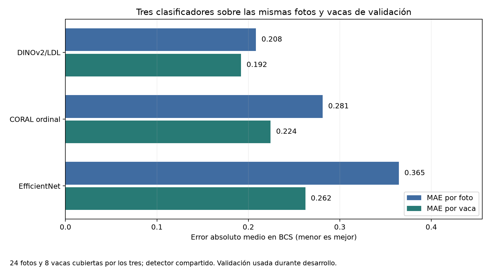
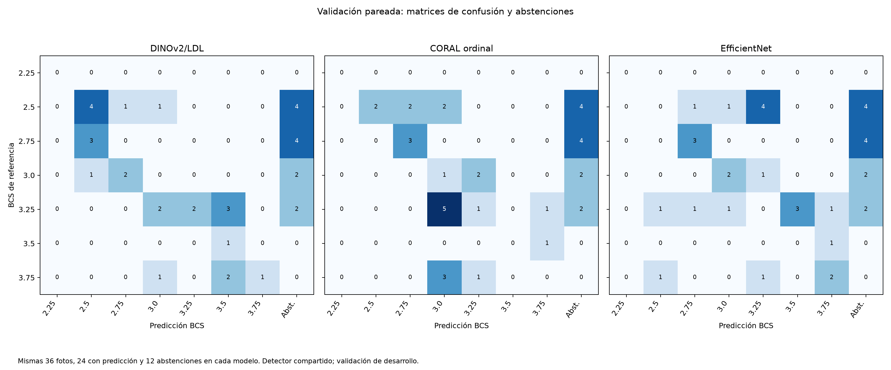
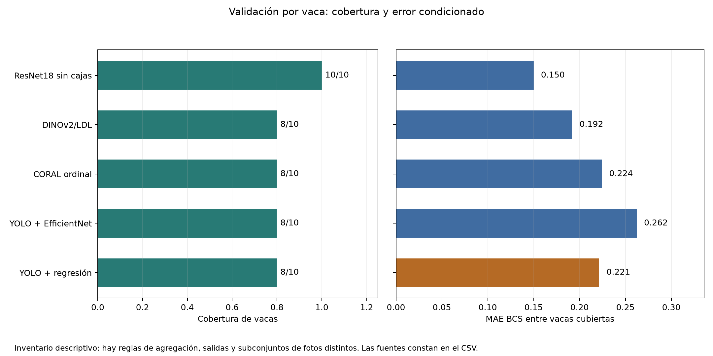

# Comparación maestra BCS: corte preliminar

**Fecha:** 12 de noviembre de 2026. **Partición:** validación. **Estado:** inventario descriptivo; todavía no es una selección de modelo.

## Qué se puede comparar hoy

Los cinco enfoques tienen alguna cifra de validación sobre 36 fotografías, pero la evidencia no es uniforme. Ya se encontraron predicciones individuales locales de los cinco enfoques; las nuevas corridas de YOLO + CORAL ordinal, DINOv2/LDL y EfficientNet de clasificación comparten detector y cubren exactamente las mismas 24 fotos. Las corridas históricas EfficientNet y ordinal v4 siguen documentadas mediante informes y no se mezclan con las nuevas. Véase [INVENTARIO.md](INVENTARIO.md) para la procedencia de cada fila.

| Sistema | Salida | Fotos con predicción / 36 | Dentro de ±0.25 / 36 | MAE en fotos con predicción |
|---|---|---:|---:|---:|
| Constante 3.0 | Categoría | 36 | 21 | 0.3472 |
| ResNet18 sin cajas | Categoría | 36 | 31 | 0.2292 |
| YOLO + EfficientNet histórico | Categoría | 30 | 16 | 0.4917 |
| YOLO + EfficientNet **nueva corrida, detector compartido** | Categoría | 24 | 14 | 0.3646 |
| YOLO + CORAL ordinal v4 | Categoría | 29 | 21 | No documentado para el flujo automático |
| YOLO + CORAL **nueva corrida** | Categoría | 24 | 17 | 0.2813 |
| La misma corrida CORAL, esperanza continua | Continua | 24 | 13 | 0.2875 |
| YOLO + DINOv2/LDL histórico | Categoría | 28 | 25 | 0.2143 |
| YOLO + DINOv2/LDL **nueva corrida** | Categoría | 24 | 21 | 0.2083 |
| La misma corrida DINO, esperanza continua | Continua | 24 | 18 | 0.2014 |
| YOLO + regresión v2 Mac | Continua | 27 | 8 | 0.3299 |

El acierto global incluye las abstenciones en el denominador; el MAE solo incluye fotografías con predicción. La cifra de ResNet18 es secundaria, por fotografía; el modelo se diseñó para una predicción conjunta por vaca. Las salidas continuas no se deben ordenar directamente contra el MAE de categorías. Los flujos con cajas usan detecciones predichas en estas filas. Las nuevas corridas CORAL, EfficientNet y DINO comparten detector y tienen las mismas 36 fotografías y estados de cobertura. Las dos salidas de cada una de las nuevas corridas CORAL y DINO son decodificaciones del **mismo modelo**, no entrenamientos adicionales. Las corridas históricas tuvieron pesos y condiciones diferentes. Las 36 fotografías no garantizan todavía identidad de archivo en todos los demás enfoques.

Los datos de ambas figuras están en [datos_agregados_validacion.csv](datos_agregados_validacion.csv). Se regeneran con `python -m evaluacion.comparacion_modelos.generar_graficas` desde la carpeta raíz del repositorio.

La comparación estricta entre los tres clasificadores que comparten las 24 fotos cubiertas y 8 vacas se muestra aparte:

Sus datos agregados están en [clasificadores_pareados_validacion.csv](clasificadores_pareados_validacion.csv); no contiene nombres de vacas ni predicciones individuales.

La figura de matrices se generó con [confusiones_pareadas.py](confusiones_pareadas.py), que comprueba el pareo de los CSV privados y guarda solo los conteos agregados, con una columna separada para abstenciones.

## Unidad principal: vaca

Los agregados de esta vista están en [datos_agregados_vaca_validacion.csv](datos_agregados_vaca_validacion.csv). Es un inventario descriptivo: ResNet18 usa su agregación nativa, la regresión produce valores continuos y los subconjuntos de fotos cubiertas difieren. La comparación pareada estricta se limita a los tres clasificadores con detector compartido.

Hay resultados por vaca verificables para los cinco enfoques. ResNet18 obtuvo MAE nativo **0.150** sobre 10 vacas de validación. El flujo YOLO + regresión v2 Mac cubrió **8 de 10** vacas, con MAE **0.2214** sobre esas 8. Las nuevas corridas DINO, CORAL y EfficientNet clasificaron las **mismas 24 fotos de 8 vacas**; bajo la regla común de promediar BCS por foto, sus MAE categóricos por vaca fueron **0.1920**, **0.2243** y **0.2623**, respectivamente. CORAL tiene también una regla ordinal nativa de agregación: MAE categórico **0.2500** sobre las 8 vacas cubiertas. Una comparación estricta entre DINO continuo y regresión usa **20 fotos de 7 vacas** donde ambos predijeron: MAE **0.1936** frente a **0.2332**. Son cifras de desarrollo y de subconjuntos pequeños; no justifican una conclusión final. ResNet18 usa otra regla nativa de agregación y tiene dos fotos aún no conciliadas con las otras fuentes. Véase [ORDINAL_CORRIDA_01.md](ORDINAL_CORRIDA_01.md), [EFFICIENTNET_CORRIDA_01.md](EFFICIENTNET_CORRIDA_01.md), [DINO_CORRIDA_01.md](DINO_CORRIDA_01.md) y [COMPARACION_LOCAL.md](COMPARACION_LOCAL.md).

## Lectura crítica

- El detector de YOLO + regresión alcanzó métricas altas de cajas en validación, pero su sistema completo emitió predicción BCS en 27 de 36 fotos. La calidad del detector y la calidad BCS son resultados distintos.
- La corrida histórica DINO cubrió 28 fotos; la nueva cubrió 24. Esta última se abstuvo en 12 (9 asociaciones ambiguas y 3 sin par válido). Su error condicionado y cobertura deben leerse juntos; no se atribuye la diferencia entre corridas a una sola causa.
- La nueva EfficientNet compartió detector con DINO y tuvo esas mismas 12 abstenciones. Su MAE con cajas anotadas sobre 36 fotos fue 0.4306, peor que el 0.3472 de la referencia constante en esas mismas 36. Su MAE de 0.3646 con cajas predichas corresponde solo a las 24 fotos cubiertas y no prueba una mejora del recorte.
- La nueva CORAL también tuvo esas mismas 12 abstenciones; MAE categórico 0.2813 en las 24 fotos cubiertas. Su selección de ajuste fino se basó en una diferencia mínima de MAE continuo por vaca frente a la cabeza (0.2646 frente a 0.2650), por lo que no se interpreta como mejora demostrada.
- El F1 macro de siete clases en las mismas 24 fotos fue 0.2431 DINO, 0.2250 CORAL y 0.2602 EfficientNet. Este orden difiere del MAE; F1 no refleja cuánto se aleja una categoría BCS equivocada. La clase 2.25 no aparece en validación y se cuenta con F1 cero. Véase [ORDINAL_CORRIDA_01.md](ORDINAL_CORRIDA_01.md).
- El informe ordinal v4 aporta cobertura y aciertos del flujo automático, pero no el MAE condicionado de esa ejecución. No se sustituye por el MAE con cajas anotadas ni por cifras de validación cruzada o `test`.
- Se verificó coincidencia de las 10 vacas y sus BCS entre ResNet18 y la regresión Mac. De 36 fotos, 34 coincidieron byte por byte. Las otras dos tienen contrapartes de la misma vaca y BCS y contenido visual muy parecido, pero falta confirmar su cadena de procesamiento; siguen fuera del pareo estricto. Véase [COMPARACION_LOCAL.md](COMPARACION_LOCAL.md).
- `test` fue consultado antes en algunas líneas de trabajo. Las cifras de este documento son de **validación de desarrollo** y no una prueba final independiente.

## Próximo cierre

Conciliar las dos fotos no idénticas entre ResNet18 y COCO, ampliar las diferencias pareadas y revisar errores por nivel BCS, abstenciones y matrices de confusión para salidas comparables. Después decidir un protocolo de prueba independiente; `test` ya fue consultado en algunas líneas históricas. La elección de un modelo debe esperar ese análisis y una revisión de la procedencia de cada ejecución.
