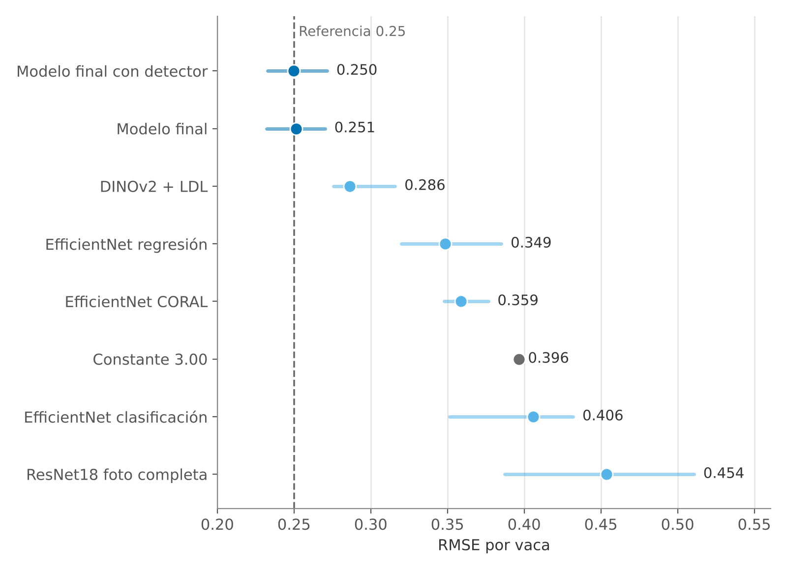

# Comparación de modelos con validación cruzada por vaca

En la retroalimentación del reporte de Evaluation el profesor nos pidió una sola tabla con todas las métricas, una fila por modelo, el RMSE frente al 0.25 de los objetivos y una gráfica de valor predicho contra valor real. Los resultados que teníamos de los modelos con ResNet18 y EfficientNet-B0 venían de 8 a 10 vacas de validación y de protocolos distintos, así que no se podían poner en la misma tabla. Por eso volvimos a entrenar los seis enfoques del equipo con las mismas fotos, las mismas vacas y los mismos pliegues. Esta carpeta tiene el código de esa corrida y sus resultados agregados.

## Cómo medimos

Usamos las 331 fotos de las 66 vacas del export "Vacones BCS - Cajas v2 Aprobado". Cada modelo se evaluó con validación cruzada de 5 pliegues agrupados por vaca, repetida 10 veces. La repetición r usa `GroupKFold(5, shuffle=True, random_state=r)`, la misma regla de la evaluación del modelo final, así que todos los modelos se miden sobre los mismos repartos y cada diferencia se mide sobre las mismas vacas. Ninguna vaca se usa para entrenar el modelo que la califica. Para la parada temprana o la elección del checkpoint, cada modelo aparta el 20 % de sus vacas de entrenamiento con `GroupShuffleSplit(0.2, random_state=r)`.

Calculamos todo por vaca, porque el rancho califica animales y no fotos. La predicción de una vaca es la media de las predicciones de sus fotos. Cada métrica se calcula en cada repetición y reportamos el promedio de las 10. Los modelos que recortan la grupa usan las cajas anotadas, para medir el modelo y no el detector. La fila "sistema completo" es el modelo final con nuestro detector buscando la grupa.

## Resultados

| Modelo | MAE | RMSE | ±0.25 | QWK | F1 vaca flaca |
|---|---|---|---|---|---|
| Modelo final DINOv2-S + ridge | 0.199 | 0.251 | 87 % | 0.73 | 0.79 |
| Modelo final con detector | 0.196 | 0.250 | 86 % | 0.73 | 0.77 |
| YOLO + DINOv2, LDL con 2 vistas | 0.226 | 0.286 | 81 % | 0.60 | 0.65 |
| YOLO + EfficientNet-B0, regresión | 0.282 | 0.349 | 68 % | 0.45 | 0.59 |
| YOLO + EfficientNet-B0, CORAL | 0.296 | 0.359 | 67 % | 0.36 | 0.43 |
| YOLO + EfficientNet-B0, clasificación | 0.328 | 0.406 | 64 % | 0.37 | 0.39 |
| ResNet18, foto completa | 0.354 | 0.454 | 60 % | 0.19 | 0.46 |
| Constante 3.00 | 0.318 | 0.396 | 59 % | 0.00 | 0.00 |

El modelo final es el mejor en todas las métricas que calculamos, y es el único con un RMSE cercano a 0.25. Con el detector da prácticamente lo mismo que con las cajas anotadas, así que el detector no agrega error. Clasificación y ResNet18 tienen más error que la constante en MAE y RMSE. La tabla completa, con R², exactitud, precisión, recall, F1 macro y ponderado, AUC y pendiente, está en [`resultados/metricas_modelos.csv`](resultados/metricas_modelos.csv), y el valor de cada repetición en [`resultados/metricas_modelos.json`](resultados/metricas_modelos.json).



## Qué cambiamos de cada receta

Mantuvimos la receta de cada carpeta del repositorio y solo cambiamos lo necesario para que todos midieran igual. En los cuatro modelos reentrenados la predicción de la vaca es la media de las predicciones de sus fotos, y el reparto de vacas viene de [`codigo/protocolo.py`](codigo/protocolo.py).

ResNet18 corrió en CPU porque su `select_device` solo elige MPS o CPU. Usó las fotos completas del export, que son las mismas del dataset sin cajas, con paciencia 1, hasta 30 épocas, AdamW con lr 1e-4, lote 16 y semilla 20261026. Su versión original promediaba probabilidades por vaca.

YOLO + EfficientNet-B0 en clasificación usa la función `train()` de `modelos/con_cajas_yolo` sin cambios y siempre el `best.keras` del ajuste fino. Armamos el manifiesto directamente, sin el ETL de esa carpeta, para usar el reparto común. El catálogo de clases sale de las vacas de entrenamiento del pliegue, como en la receta original, así que cuando la única vaca de 2.25 cae en validación sus fotos se quitan de validación, y cuando cae en prueba el modelo no puede predecir 2.25.

YOLO + EfficientNet-B0 en regresión reproduce las celdas 23 a 38 del notebook `entrenar_yolo_regresion_v2_mac.ipynb`. La única diferencia es el entorno, TensorFlow 2.20 con CUDA en lugar de 2.18 con Metal, y que las cajas se leen de las etiquetas YOLO del export.

EfficientNet-B0 con CORAL usa las funciones del experimento B de `bcs_ordinal.py` sin cambios. Los cambios son el reparto, con `GroupShuffleSplit` en lugar de `StratifiedShuffleSplit` para la validación interna, las 66 vacas en lugar de 56 y la regla CORAL aplicada a cada foto antes de promediar. Conserva su catálogo, que junta los niveles 2.25 y 2.50.

DINOv2 + LDL, el modelo final, el sistema completo y la constante salen de los scripts del modelo final (`comparar_ldl.py` y `evaluar_sistema.py`), que ya usaban este mismo protocolo.

## Cómo reproducir

Se necesitan el export de Roboflow y el CSV de metadatos, que son privados. El formato del CSV está en [`modelos/Modelo final DINOv2 ridge BCS/examples`](../../modelos/Modelo%20final%20DINOv2%20ridge%20BCS/examples/). Los scripts leen las rutas de tres variables de entorno:

```bash
export BCS_DATOS="/ruta/al/export/Vacones BCS - Cajas v2 Aprobado.yolo26"
export BCS_METADATA="/ruta/a/metadata_bcs_validos.csv"
export BCS_PRIVADO="/ruta/fuera/del/repo/privado"   # opcional, por defecto ./privado
```

En Windows con PowerShell se definen con `$env:BCS_DATOS = "..."`.

Primero se corren los dos scripts del modelo final con la carpeta privada como último argumento. Así se guardan las predicciones del modelo final, del sistema completo, de la constante y de DINOv2 + LDL, y el orden de vacas que usan los demás:

```bash
cd "modelos/Modelo final DINOv2 ridge BCS/codigo"
python evaluar_sistema.py "$BCS_DATOS" "$BCS_METADATA" ../modelo/pesos/dinov2_vits14.safetensors ../modelo/detector/best.pt sistema.json "$BCS_PRIVADO"
python comparar_ldl.py "$BCS_DATOS" "$BCS_METADATA" ../modelo/pesos/dinov2_vits14.safetensors cierre.json "$BCS_PRIVADO"
```

Después se reentrenan los cuatro modelos, cada uno en el entorno de su carpeta, desde `evaluacion/comparacion_validacion_cruzada/codigo`. Cada repetición se guarda en `BCS_PRIVADO/parciales`, así que una corrida interrumpida sigue desde la última repetición terminada. También se puede pasar la lista de repeticiones, por ejemplo `python resnet18.py 0 1 2`.

```bash
python resnet18.py               # entorno de modelos/sin_cajas_resnet
python effnet_coral.py           # entorno de modelos/con_cajas_ordinal
python effnet_clasificacion.py   # entorno TensorFlow de modelos/con_cajas_yolo (requirements-tf.txt), GPU obligatoria
python effnet_regresion.py       # mismo entorno TensorFlow, GPU obligatoria
```

En Windows, CORAL corre con Keras sobre PyTorch, que es como lo configura `bcs_ordinal.py`. Los dos modelos de TensorFlow los corrimos en WSL con Ubuntu y Python 3.12, porque TensorFlow ya no usa la GPU en Windows nativo. En una laptop con RTX 4060 las 10 repeticiones tardaron aproximadamente 50 minutos con ResNet18, 99 con CORAL, 99 con clasificación y 183 con regresión. Conviene correr un modelo de GPU a la vez y dejar la laptop conectada y abierta, porque si se suspende el entrenamiento se detiene.

Al final se calculan las métricas y las figuras:

```bash
python calcular_metricas.py "$BCS_PRIVADO" modelos.json ../resultados
python figura_rmse.py ../resultados/metricas_modelos.json modelos.json ../resultados
```

## Privacidad

Todo lo que se escribe en `BCS_PRIVADO` tiene identificadores reales de vacas, su BCS, recortes de fotos o pesos por pliegue, y no se sube a GitHub ni al Drive. La carpeta `privado/` está en `.gitignore`. Los archivos de [`resultados/`](resultados/) son agregados por modelo y por repetición, sin identificadores ni nombres de fotos. Las gráficas de predicho contra real muestran un punto por vaca sin identificarla.

## Contenido

`codigo/protocolo.py` arma la tabla de fotos, los pliegues y la validación interna, y guarda y une las repeticiones. `codigo/resnet18.py`, `codigo/effnet_clasificacion.py`, `codigo/effnet_regresion.py` y `codigo/effnet_coral.py` reentrenan cada modelo del equipo. `codigo/calcular_metricas.py` calcula la tabla, la matriz de confusión del modelo final y las gráficas de predicho contra real, y `codigo/figura_rmse.py` hace la gráfica de RMSE. `codigo/modelos.json` define el orden y los nombres de los modelos. El reporte con la explicación de cada métrica está en el Drive del equipo, en la carpeta de Evaluation.
